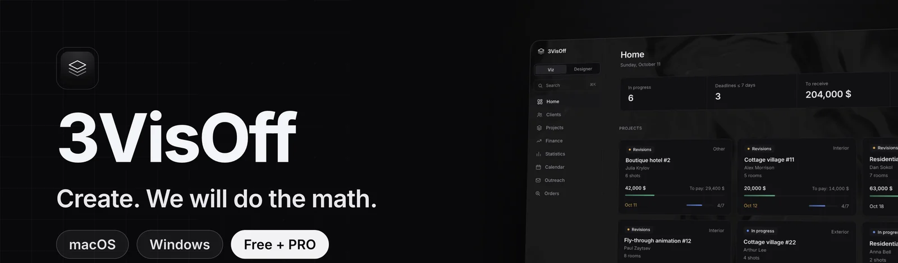
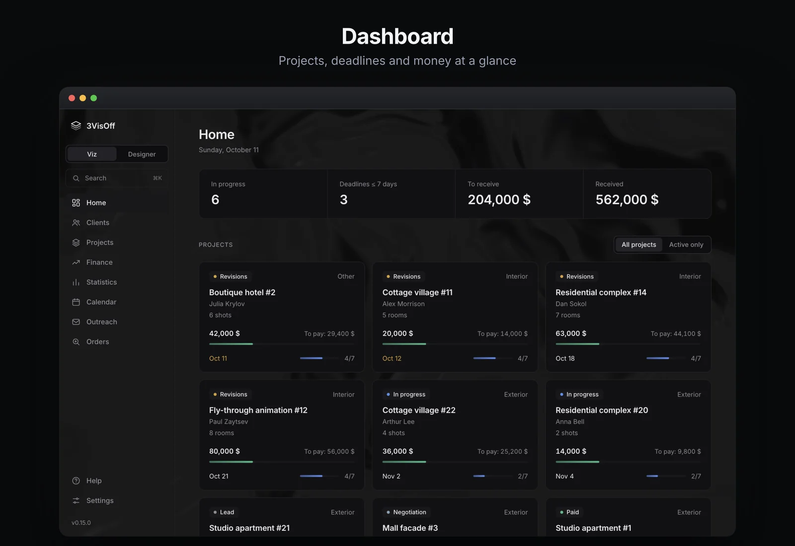
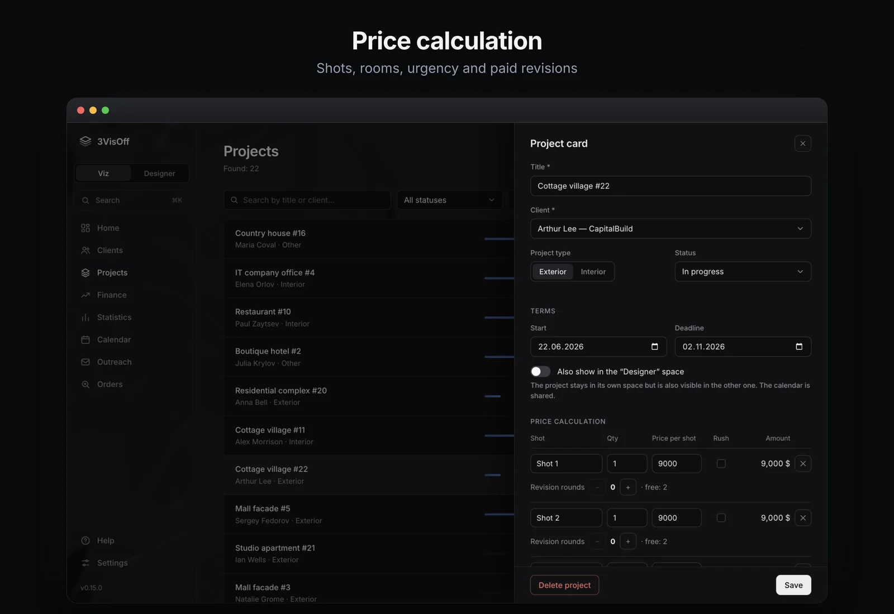
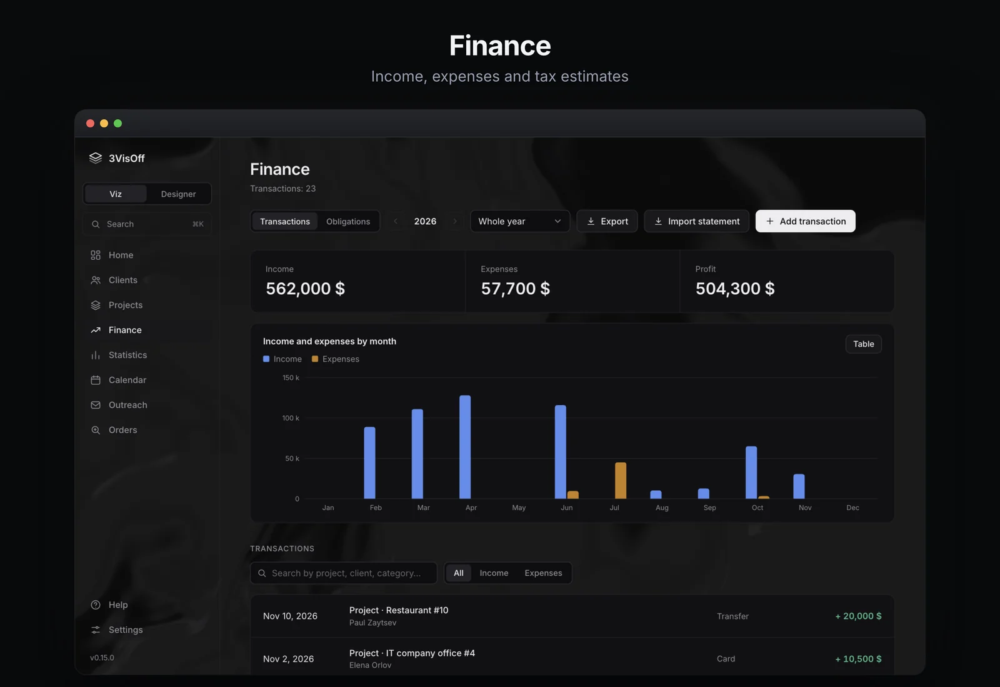
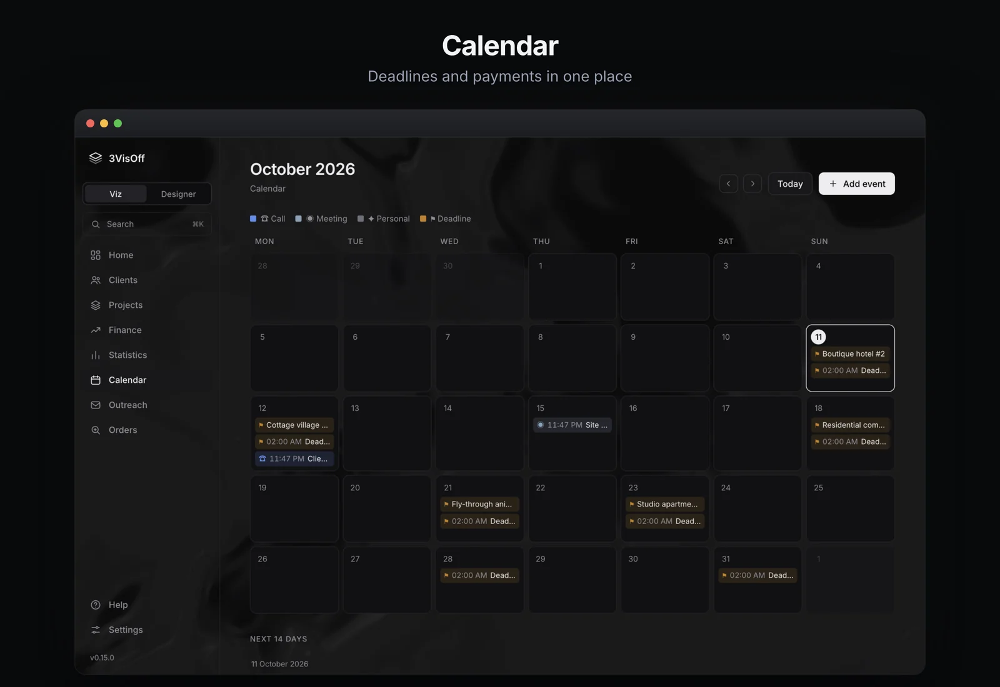
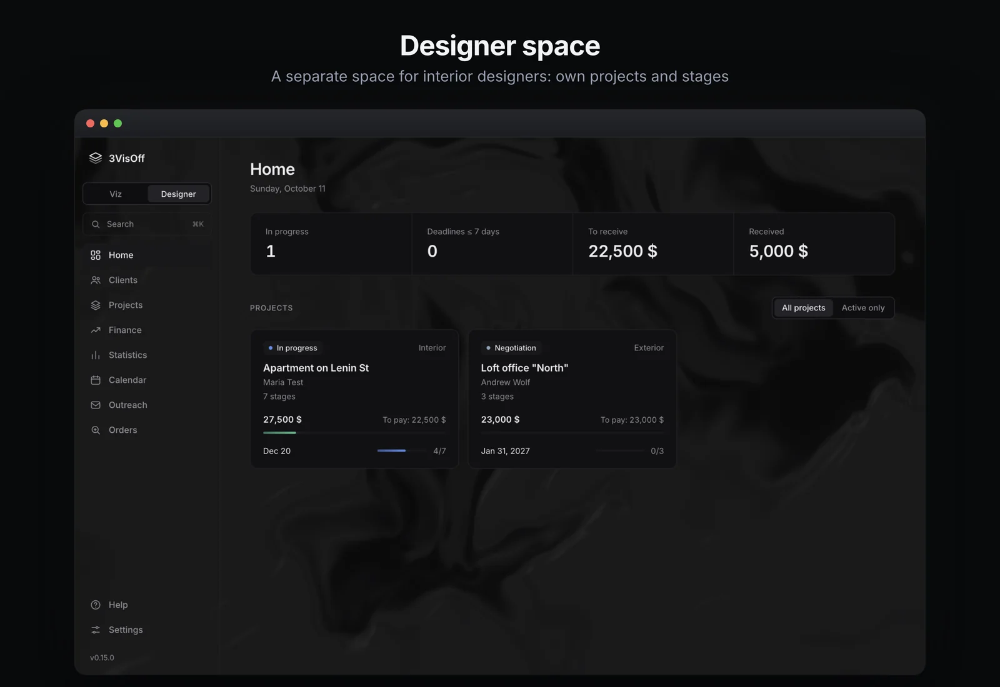
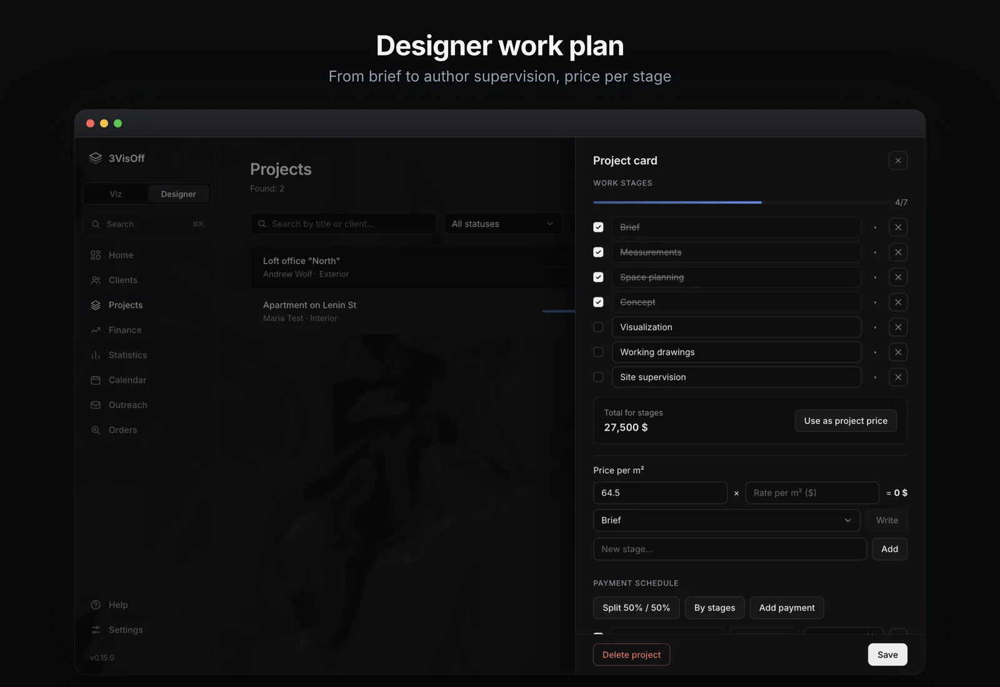

<div align="center">

<a href="https://github.com/AdeptVision3D/3VisOff-releases/releases/latest"></a>

[](https://github.com/AdeptVision3D/3VisOff-releases/releases/latest)  

### [Download the latest version](https://github.com/AdeptVision3D/3VisOff-releases/releases/latest)

Free. PRO from $9 per 30 days. A 7-day trial key is available on request.

[Features](#features) · [Screenshots](#what-it-looks-like) · [PRO and pricing](#pro-and-pricing) · [Install](#install) · [Privacy](#privacy) · [Support](#support) · [Русский](README.md)

</div>

<br>

**3VisOff** is a desktop app for freelance **3D visualizers** and **interior designers**: project price, invoice, act, tax and payment reminders in a couple of clicks instead of an evening with spreadsheets. Two modes in one window: **Визер** (visualizer) for renders and **Дизайнер** (designer) for interior projects. No cloud, no accounts: **all data stays on your computer.** The interface is available in Russian and English.

> Note: tax features (estimate of the Russian self-employed tax, NPD, 4% / 6%) and requisites lookup by INN are specific to Russia.

## Features

| | |
|---|---|
| **Clients** | Who, what, when and how much they owe. The full history with every client. |
| **Price in a minute** | Shots, square meters, urgency, paid revisions. The total goes into the project with one button. |
| **Documents** | Invoices as PDF, filled in from project data. Acts and contracts: PRO. |
| **Money** | Who paid, how much to set aside for tax, reminders before the due date. |
| **Orders** | Orders from 3ddd and job-board emails in one list, junk filtered out (PRO). |
| **Privacy** | No cloud, no accounts. PIN protection and backups. |
| **Designer mode** | From brief to author supervision: stages, procurement list, payment schedule. Free. |
| **Sync** | The same data on several computers through a cloud folder (PRO). |

### Included in the free version

- projects, clients, statuses, deadlines, search across everything (⌘K / Ctrl+K);
- price calculation: shots, rooms by area, urgency, discount, paid revisions;
- invoice as PDF; blank act and contract templates;
- finance: income and expenses, statistics, Russian self-employed tax estimate, obligations and reminders, export to CSV;
- calendar with reminders;
- the whole Designer space;
- PIN, backups and restore, light, dark and monochrome themes, Russian and English interface.

## What it looks like

<p align="center">
  
</p>
<p align="center">
  
</p>
<table>
<tr>
<td width="50%"></td>
<td width="50%"></td>
</tr>
</table>

### Designer space (free)

From brief to author supervision in one place. Switch between "Визер" and "Дизайнер" in the sidebar. Each space has its own projects, stages and price calculation; clients, calendar, finance and settings are shared.

- **Work plan by stages:** brief, measurements, layout, concept, visualization, working documentation, procurement, author supervision.
- **Price per stage**, per-m² calculation and a total in one click.
- **Payment schedule:** equal parts or per stage; marking "paid" creates the income entry in finance.
- **Invoice and act per stage** as PDF.
- **Approval log:** versions, statuses and paid revisions kept for disputes.
- **Procurement list:** items, suppliers, statuses, designer's percentage, Excel export.
- **Author supervision:** visits go into the calendar, checklist, payment per visit, per month or as a percentage of the renovation budget.
- **Client brief:** 22 questions, printable form and the filled brief as PDF.

<p align="center">
  
</p>
<p align="center">
  
</p>

### What PRO adds

| Feature | What it does |
|---|---|
| Acts and contracts | Project and client data are filled in automatically, contract wizard, history, your own templates |
| Send by email | Invoice, act and contract go to the client from your Gmail |
| Payment QR and bank statement | QR in the invoice, import of income from a bank statement |
| Branded documents | Your logo and colors in invoices, acts and contracts |
| Telegram notifications | Reminders reach your phone through your own bot |
| Outreach | Cold email to a list of companies from your mailbox, reply notifications |
| **Orders** | Orders from 3ddd and from job-board notification emails in your mailbox are collected into one list |
| Sync | The same data on several computers through a cloud folder |

Release notes: [Releases](https://github.com/AdeptVision3D/3VisOff-releases/releases).

## PRO and pricing

The base version is **free** and stays free. PRO is unlocked with a key; no internet is needed to verify it.

| Term | Price (USDT) | Per month |
|---|---|---|
| 30 days | **$9** | $9 |
| 90 days | **$20** | ≈ $6.7 |
| 180 days | **$34** | ≈ $5.7 |

Payment is in **USDT**; the support bot sends the details. A **7-day trial key** with part of the PRO features is available. Buy a key or get a trial: Telegram bot [@visoff_support_bot](https://t.me/visoff_support_bot).

## Install

### Windows

1. Download `3VisOff-Setup-….exe` from **Assets** of the [latest release](https://github.com/AdeptVision3D/3VisOff-releases/releases/latest) and run it.
2. Windows may show "Unknown publisher" (the app is not code-signed yet). Click **More info**, then **Run anyway**.
3. Updates arrive by themselves; your data is kept.

### macOS (Apple Silicon: M1, M2, M3 and newer)

The app is not yet signed by Apple, so macOS warns about an unknown developer on first launch. This is expected; you only need to allow it once.

1. Download `3VisOff-…-arm64.dmg` from **Assets** of the [latest release](https://github.com/AdeptVision3D/3VisOff-releases/releases/latest).
2. Open it and drag **3VisOff** to **Applications**, then eject the installer.
3. Open **Terminal**, paste the command and press Enter:

```bash
xattr -cr /Applications/3VisOff.app
```

   It prints nothing; that is normal. It removes the "downloaded from the internet" flag.
4. Open 3VisOff from Applications.

<details>
<summary>If you prefer not to use Terminal</summary>

1. Try to open 3VisOff. macOS shows a warning; click "Done".
2. Open **System Settings → Privacy & Security**, scroll down to the message about 3VisOff and click **Open Anyway**. Confirm with your password or Touch ID.

</details>

### Updates

When a new version is out the app offers to update: click "Update" and it downloads and restarts. A backup of your data is saved automatically first. Data lives in `~/Library/Application Support/3VisOff` (macOS) and is kept when you reinstall.

## Privacy

Your clients, projects, amounts and documents are **never sent to the developer**. The app uses the internet only to check for updates (GitHub) and for functions you turned on yourself (Gmail, your Telegram bot, requisites lookup by INN, order search). Anonymous statistics and error reports are off by default and are sent only with your consent.

Full list of what goes where: **[PRIVACY.en.md](PRIVACY.en.md)** ([in Russian](PRIVACY.md)). The same text is in the app: Settings → "Privacy and reports".

## Support

- Questions, PRO keys, trial, bug reports: Telegram bot [@visoff_support_bot](https://t.me/visoff_support_bot).
- The app has a **Help** section with answers to common questions and a "Report a problem" button.
