<div align="center">

<a href="https://github.com/AdeptVision3D/3VisOff-releases/releases/latest">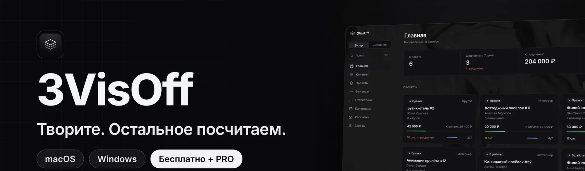</a>

[](https://github.com/AdeptVision3D/3VisOff-releases/releases/latest)  

### [Скачать последнюю версию](https://github.com/AdeptVision3D/3VisOff-releases/releases/latest)

Бесплатно. PRO от 650 ₽ в месяц. Пробный ключ на 7 дней по запросу.

[Возможности](#возможности) · [Скриншоты](#как-это-выглядит) · [PRO и цены](#pro-и-цены) · [Установка](#установка) · [Приватность](#приватность) · [Поддержка](#поддержка) · [English](README.en.md)

</div>

<br>

**3VisOff** — программа для **3D-визуализаторов** и **дизайнеров интерьеров**: цена проекта, счёт, акт, налог и напоминание об оплате за пару кликов, а не за вечер с таблицами. Два режима в одном окне: **«Визер»** для рендеров и **«Дизайнер»** для проектов интерьера. Ни облака, ни аккаунтов: всё работает на вашем компьютере.

## Возможности

| Что | Как |
|---|---|
| **Клиенты** | Кто, что, когда и сколько должен. Вся история с каждым клиентом. |
| **Цена за минуту** | Кадры, метры, срочность, платные правки. Итог в проект одной кнопкой. |
| **Документы** | Счёт в PDF собирается из данных проекта. Акт и договор: PRO. |
| **Деньги** | Кто заплатил, сколько отложить на налог, напоминания до срока. |
| **Заказы** | Заказы с 3ddd и из писем бирж в одном списке без мусора (PRO). |
| **Приватность** | Ни облака, ни аккаунтов. PIN-код и резервные копии. |
| **Режим «Дизайнер»** | От брифа до авторского надзора: этапы, комплектация, график оплат. Бесплатно. |
| **Синхронизация** | Данные на нескольких компьютерах через облачную папку (PRO). |

### Что входит в бесплатную версию

- проекты, клиенты, статусы, сроки, поиск по всему (⌘K / Ctrl+K);
- расчёт цены: кадры, помещения по площади, срочность, скидка, платные правки;
- счёт в PDF; пустые бланки акта и договора;
- финансы: доходы и расходы, статистика, оценка налога самозанятого, обязательства и напоминания, выгрузка в Excel (CSV);
- календарь с напоминаниями;
- всё пространство «Дизайнер» (см. ниже);
- PIN-код, резервные копии и восстановление, светлая, тёмная и чёрно-белая темы, русский и английский интерфейс.

PRO добавляет автоматизацию и интеграции ([список ниже](#что-даёт-pro)).

## Как это выглядит

<p align="center">
  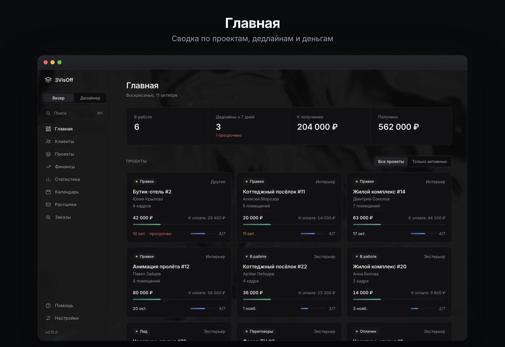
</p>
<p align="center">
  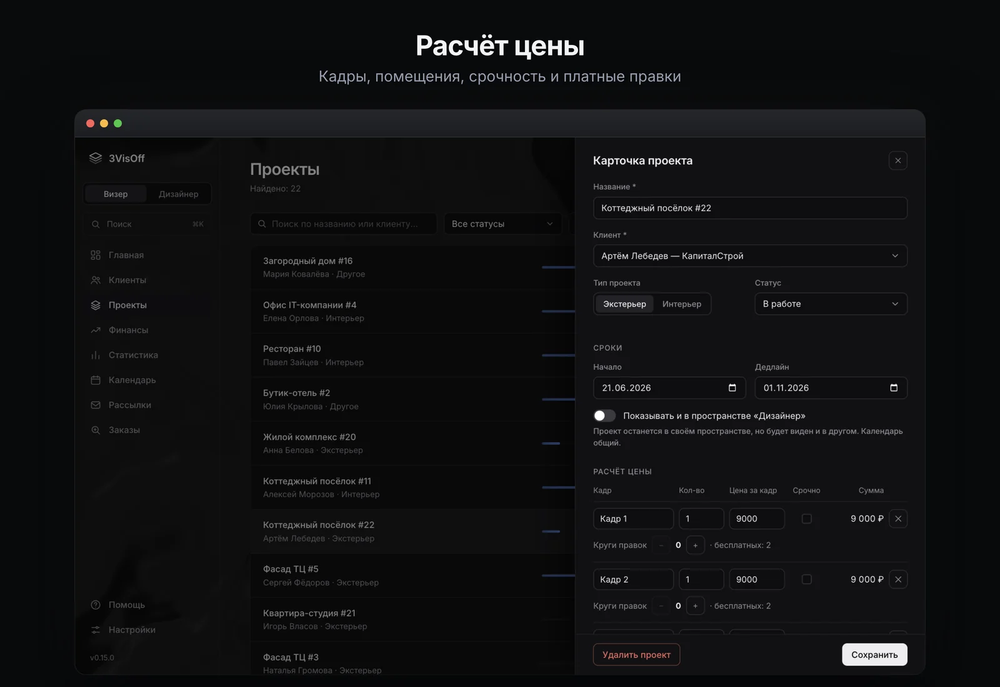
</p>
<table>
<tr>
<td width="50%">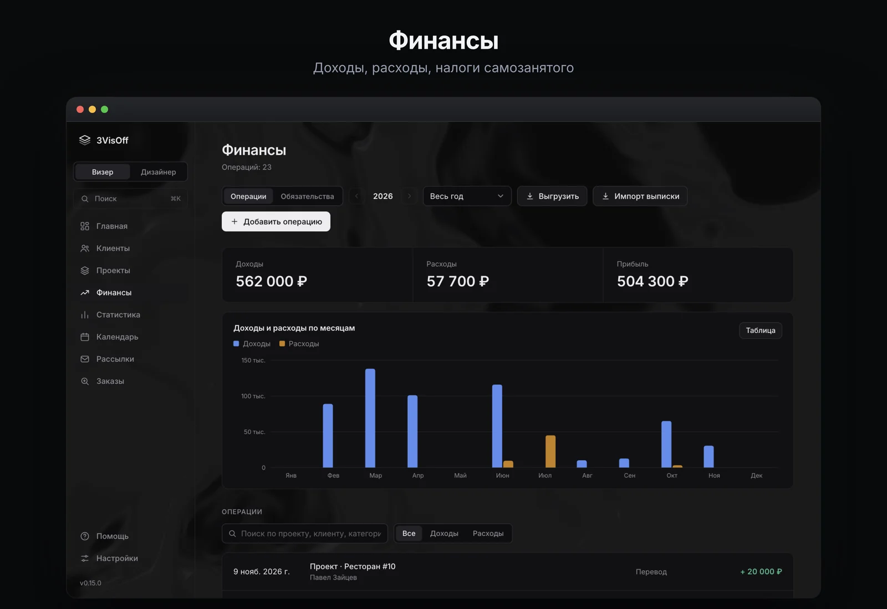</td>
<td width="50%">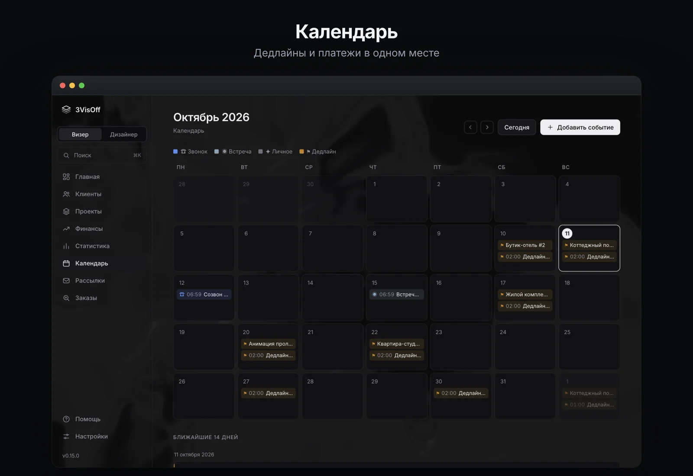</td>
</tr>
</table>

<details>
<summary>Ещё скриншоты</summary>

<table>
<tr>
<td width="50%">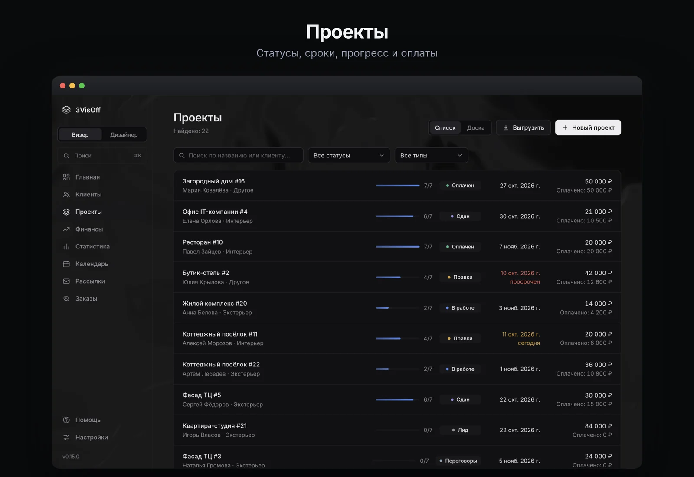</td>
<td width="50%">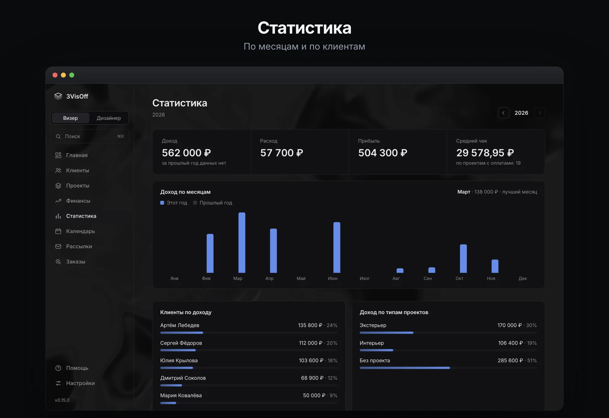</td>
</tr>
<tr>
<td>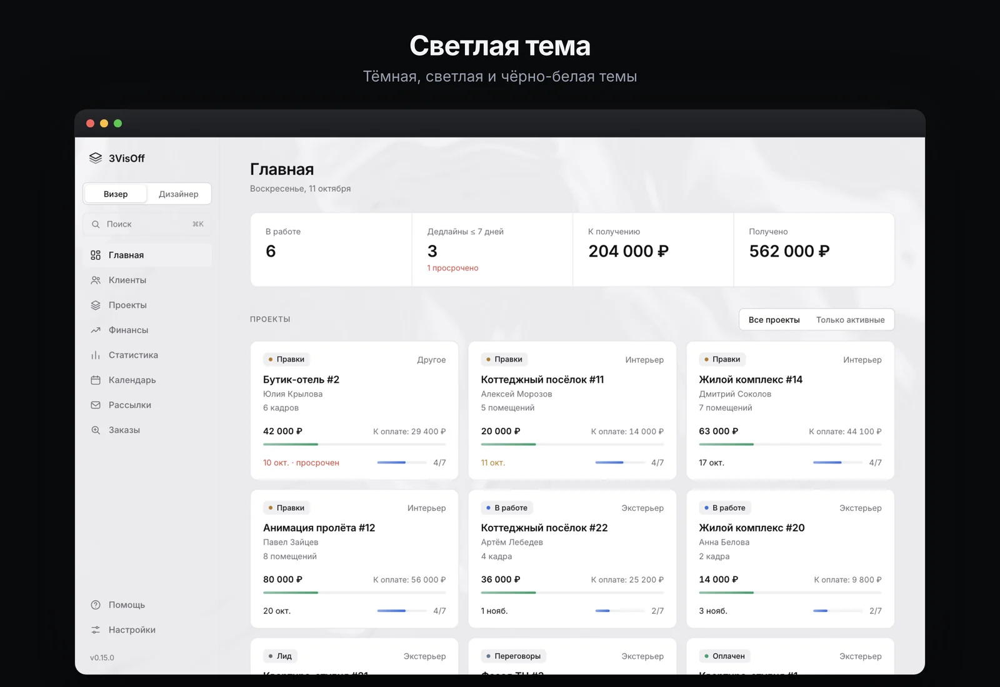</td>
<td>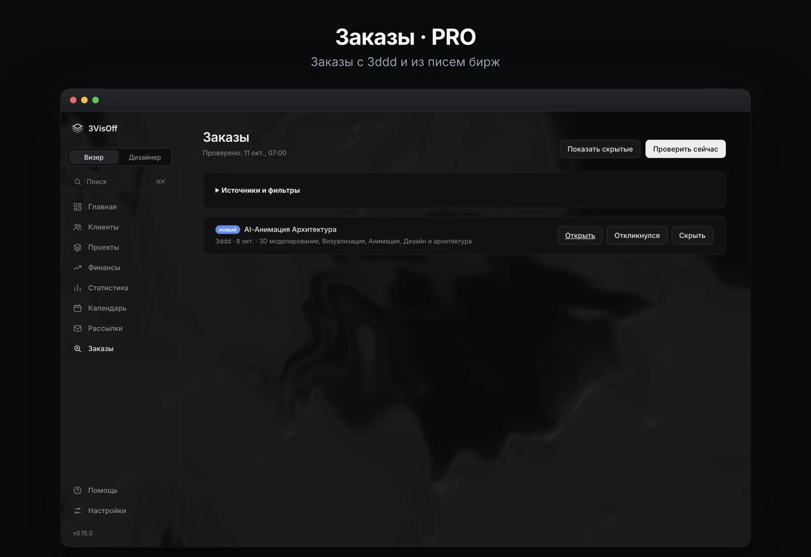</td>
</tr>
</table>

</details>

### Пространство «Дизайнер» (бесплатно)

От брифа до авторского надзора в одном месте. Версии и правки лежат в журнале. Отдельное пространство для дизайнеров интерьеров, переключатель «Визер / Дизайнер» в боковом меню. У каждого пространства свои проекты, этапы и расчёт цены; клиенты, календарь, финансы и настройки общие. Любой проект можно показать и в другом пространстве. Если вы пользовались программой раньше, вы остаётесь в «Визере», данные не меняются.

- **План работ по этапам:** бриф, обмеры, планировочные решения, концепция, визуализация, рабочая документация, комплектация, авторский надзор. Этапы с галочками и своими полями; типы проектов «Интерьер», «Экстерьер», «Коммерция».
- **Цена проекта по этапам**, расчёт за м² и итог одной кнопкой.
- **График оплат:** «поровну» или «по этапам»; отметка «оплачено» сама создаёт приход в финансах.
- **Счёт и акт по этапам** в PDF с подписью «Оплачено ранее».
- **Журнал согласований:** версии, статусы, платные правки, история версий для споров о правках.
- **Ведомость комплектации:** позиции, поставщики, статусы, процент дизайнера, выгрузка в Excel.
- **Авторский надзор:** выезды попадают в календарь, чек-лист, оплата за выезд, за месяц или процентом от бюджета ремонта.
- **Карточка объекта:** адрес, площадь, прораб, помещения.
- **Бриф клиента:** 22 вопроса, бланк и бриф с ответами в PDF, перенос ответов в карточку объекта.

<p align="center">
  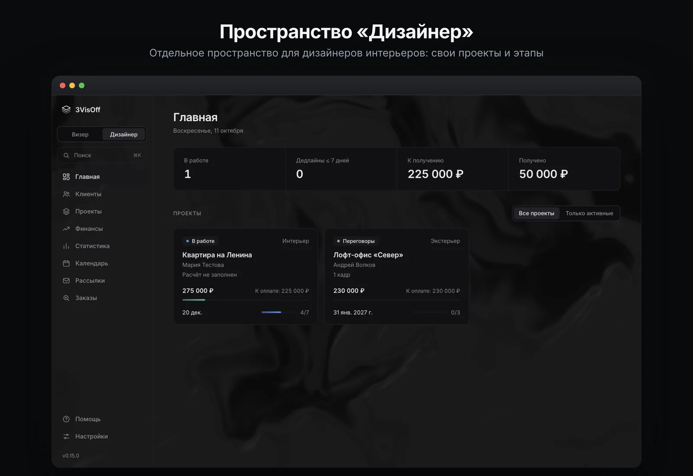
</p>
<table>
<tr>
<td width="50%">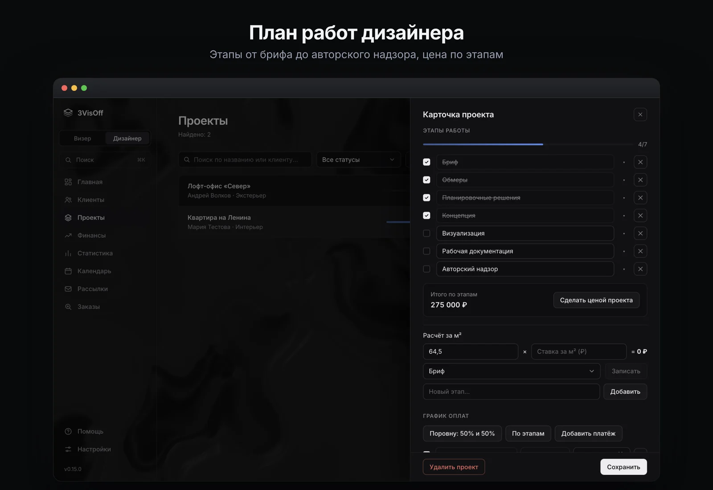</td>
<td width="50%">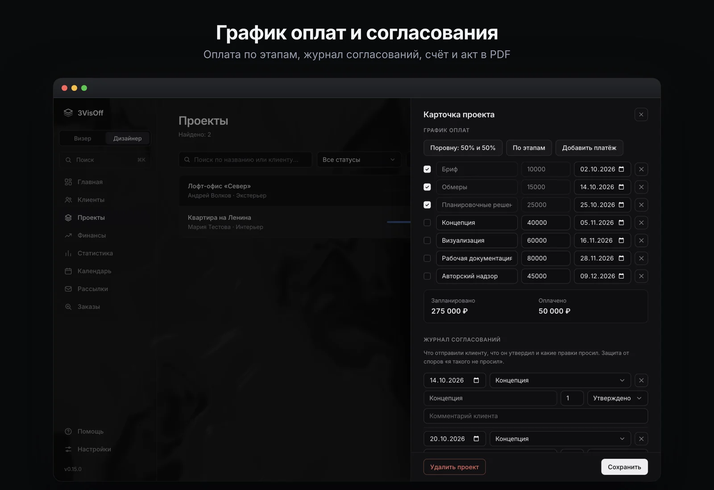</td>
</tr>
</table>

### Что даёт PRO

| Функция | Что делает |
|---|---|
| Акт и договор | Данные проекта и клиента подставляются сами, мастер договора, история, свои шаблоны |
| Отправка по почте | Счёт, акт и договор уходят клиенту прямо из программы с вашей почты Gmail |
| Реквизиты по ИНН | Название, адрес и руководитель организации подставляются по номеру ИНН |
| QR-код оплаты и выписка | QR в счёте для оплаты в приложении банка, импорт доходов из банковской выписки |
| Документы с брендом | Ваш логотип и цвета в счёте, акте и договоре |
| Уведомления в Telegram | Напоминания об оплатах и событиях приходят на телефон (через вашего собственного бота) |
| Рассылки | Холодные рассылки по списку компаний с вашей почты, уведомления об ответах |
| **Заказы** | Заказы со страницы 3ddd и из писем-уведомлений бирж в вашей почте собираются в один список, мусор убирается |
| Синхронизация | Одни и те же данные на нескольких компьютерах через облачную папку |

Подробный журнал изменений: [релизы](https://github.com/AdeptVision3D/3VisOff-releases/releases).

## PRO и цены

Базовая версия **бесплатна** и остаётся такой. PRO подключается ключом (интернет для проверки ключа не нужен).

| Срок | Цена, ₽ | Цена, $ (USDT) | В месяц |
|---|---|---|---|
| 30 дней | **650 ₽** | **$9** | 650 ₽ / $9 |
| 90 дней | **1 590 ₽** | **$20** | ≈ 530 ₽ / ≈ $6,7 |
| 180 дней | **2 690 ₽** | **$34** | ≈ 450 ₽ / ≈ $5,7 |

Оплата из России: перевод на карту или по СБП. Из других стран: **USDT** (подробности пришлёт бот поддержки).

Можно попросить **пробный ключ на 7 дней** с частью функций PRO. Купить ключ или получить пробный: бот поддержки [@visoff_support_bot](https://t.me/visoff_support_bot).

## Установка

### Windows

1. Скачайте `3VisOff-Setup-….exe` из блока **Assets** [последнего релиза](https://github.com/AdeptVision3D/3VisOff-releases/releases/latest) и запустите.
2. Windows может показать предупреждение «Неизвестный издатель» (у программы пока нет цифровой подписи). Нажмите **«Подробнее»**, затем **«Выполнить в любом случае»**.
3. Обновления приходят сами: программа предложит обновиться, данные сохраняются.

### macOS (Apple Silicon: M1, M2, M3 и новее)

Программа пока без подписи Apple, поэтому при первой установке macOS предупреждает, что не знает разработчика. Это нормально: нужно один раз разрешить запуск.

1. Скачайте `3VisOff-…-arm64.dmg` из блока **Assets** [последнего релиза](https://github.com/AdeptVision3D/3VisOff-releases/releases/latest).
2. Откройте файл и перетащите **3VisOff** в папку **«Программы»**, затем извлеките установщик (⏏ в Finder).
3. Откройте **Терминал** (`⌘ Пробел`, «Терминал», Enter), вставьте команду и нажмите Enter:

```bash
xattr -cr /Applications/3VisOff.app
```

   Она ничего не покажет, это нормально: так macOS снимает пометку «скачано из интернета».
4. Откройте 3VisOff из «Программ». Готово.

<details>
<summary>Если не хочется использовать Терминал</summary>

1. Попробуйте открыть 3VisOff. macOS покажет предупреждение, нажмите «Готово».
2. Откройте **Системные настройки → Конфиденциальность и безопасность**, прокрутите вниз до сообщения про 3VisOff и нажмите **«Всё равно открыть»**. Подтвердите паролем или Touch ID.

</details>

### Обновления

Когда выходит новая версия, программа сама предложит обновиться: нажмите «Обновить», она скачает новую версию и перезапустится. Перед обновлением автоматически сохраняется резервная копия данных. Данные лежат в `~/Library/Application Support/3VisOff` (macOS) и не удаляются при переустановке.

## Приватность

Ваши клиенты, проекты, суммы и документы **не отправляются разработчику никогда**. Программа обращается к интернету только для проверки обновлений (GitHub) и для тех функций, которые вы включили сами (почта Gmail, ваш Telegram-бот, поиск реквизитов по ИНН, поиск заказов). Анонимная статистика и отчёты об ошибках выключены по умолчанию и отправляются только с вашего согласия.

Полный список, что и куда уходит: **[PRIVACY.md](PRIVACY.md)**. Он же есть в программе: Настройки → «Конфиденциальность и отчёты».

## Поддержка

- Вопросы, ключи PRO, пробный период, сообщения об ошибках: бот [@visoff_support_bot](https://t.me/visoff_support_bot).
- Внутри программы есть раздел **«Помощь»** с ответами на частые вопросы и кнопкой «Сообщить о проблеме».

